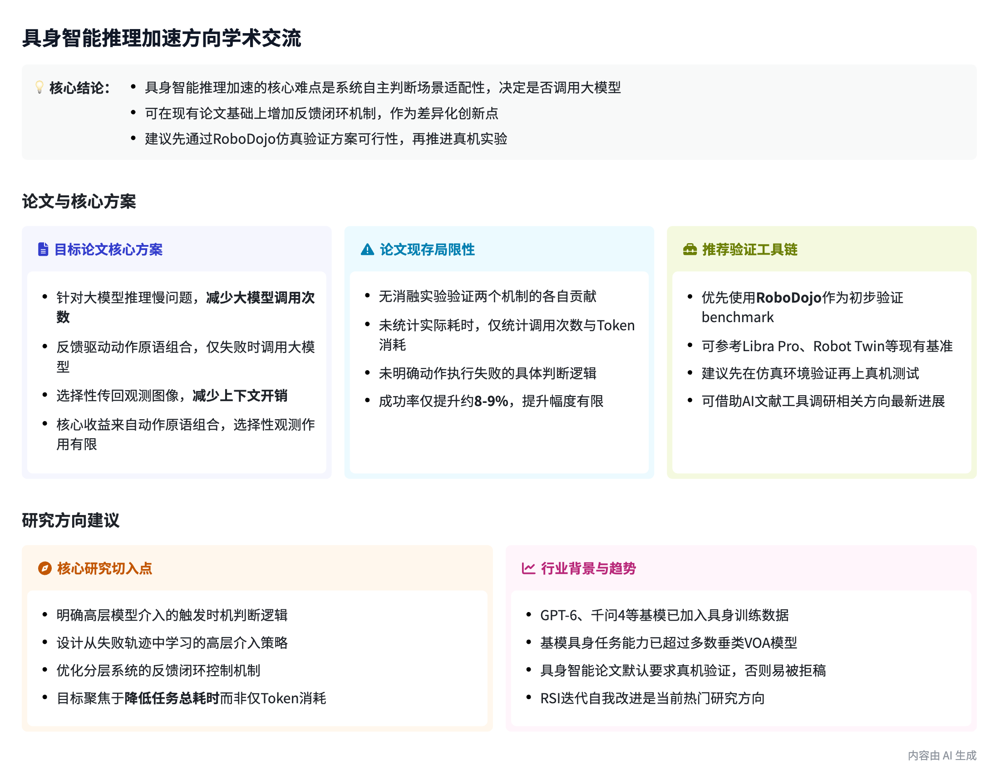

# Embodied Agent Research Log

具身 Agent 推理效率与自适应规划的长期研究记录。以问题、证据和实验为核心，逐步整理文献、设计与结果。

## 目前研究问题

- **RQ01**：何时将控制权交还给高层模型？
- **RQ02**：如何根据失败类型进行分层恢复？
- **RQ03**：如何在控制变量后证明机制有效，并衡量端到端耗时而不只是 Token？

这些问题目前是研究构想，而非已验证的结论。

## 已有记录

- 10.9 PyRUA-Lean / *Fewer Tokens, Better Action*：精读笔记 [`docs/assets/pyrualean-reading-notes.pdf`](docs/assets/pyrualean-reading-notes.pdf)。
- 10.10 

## 资源整理

### 论文与研究
- [Agentic Robotics 文献调研](https://wam-survey-research.gaw418094.chatgpt.site/agentic-robotics) — 具身智能 Agent 相关论文与研究进展。

### 仿真与实验平台
- [RoboDojo 官方网站](https://robodojo-benchmark.com/) — 机器人操作仿真与真机评估基准。
- [RoboDojo GitHub](https://github.com/RoboDojo-Benchmark/RoboDojo) — 官方开源代码及环境配置。
- [RoboDojo 使用文档](https://robodojo-benchmark.com/doc/usage/) — 环境部署与实验指南。
